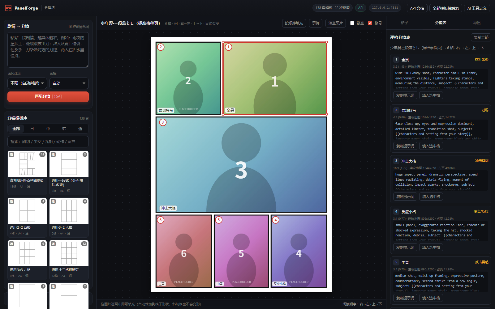
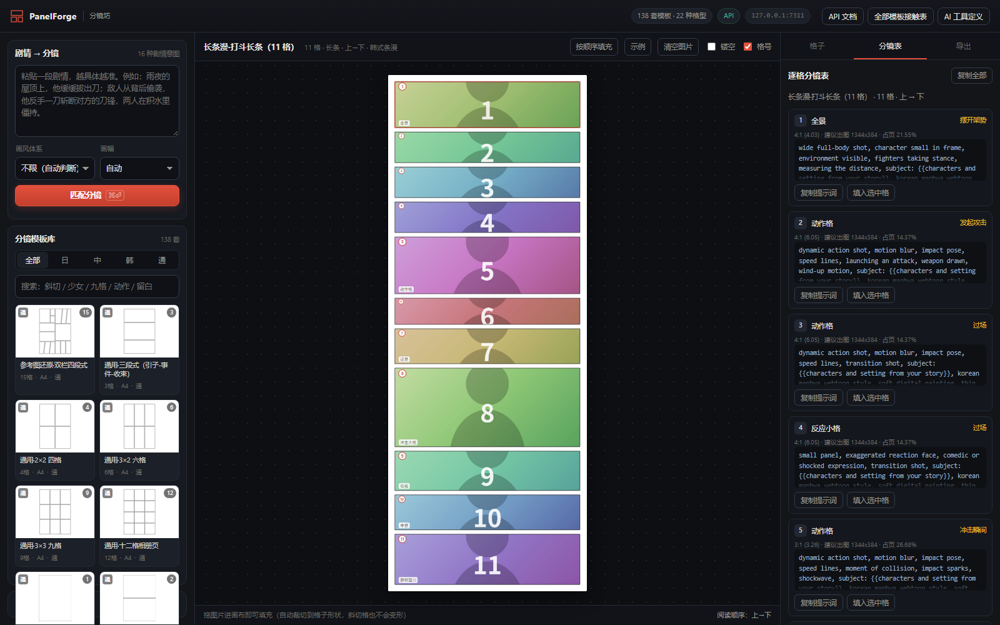
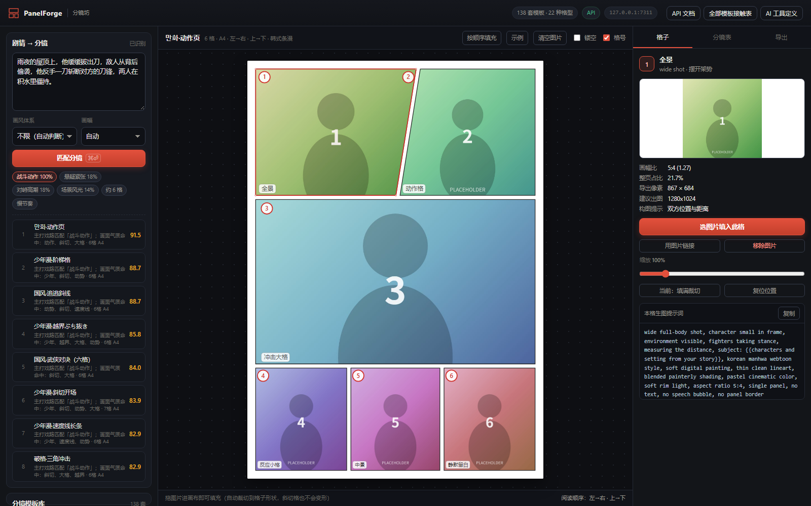
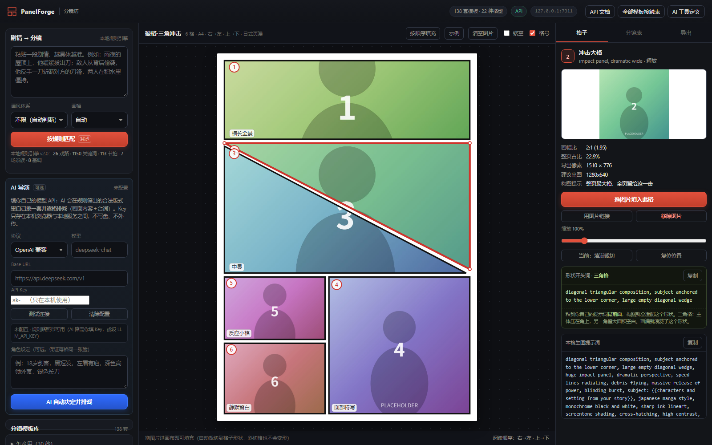
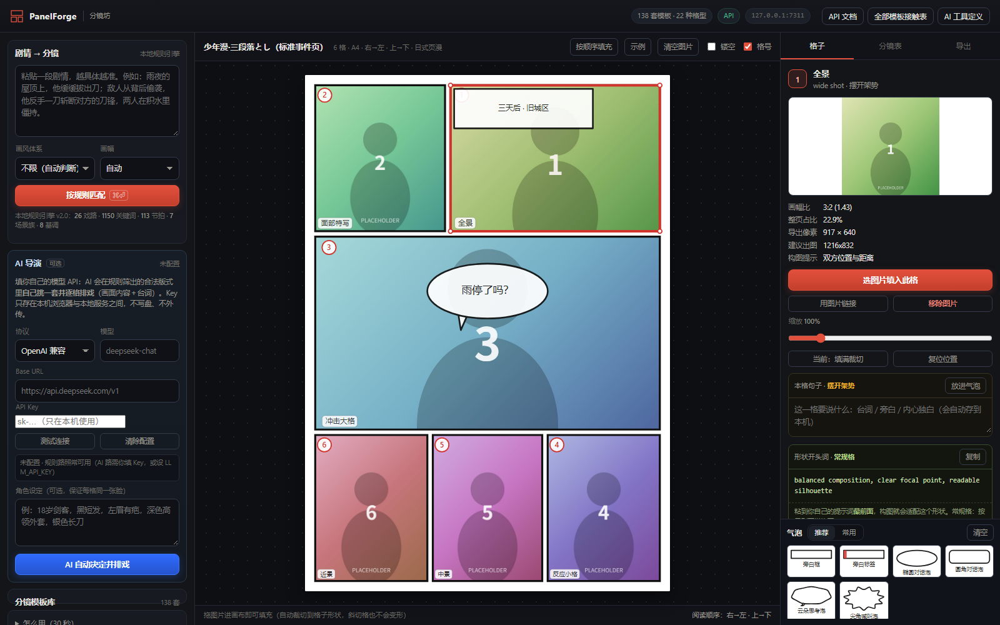

# PanelForge · 分镜坊

**138 套中日韩漫画分镜模板 · 镂空填充网页编辑器 · 剧情匹配 API**

给 AI 漫画一副「像人画的」版面骨架：格子有大小差、有斜切、有留白、有越界、有叠压插入格——
而不是九宫格平铺。每一格还带景别、构图意图和可直接喂给文生图模型的提示词。



上图为 `jp-shonen-3tier`（少年漫·三段落とし）：右→左阅读、大格冲击、图片自动裁进格子。
下面两张分别是韩式长条漫（11 格一镜到底）与「剧情 → 匹配」实况：





---

## 它解决什么问题

传统 AI 漫画的「廉价感」八成来自版面，不是画技：

| 廉价感来源 | 真实漫画怎么处理 | 本工具怎么做 |
| --- | --- | --- |
| 每格一样大、等距平铺 | 大ゴマ / 小格 / 留白 拉开节奏 | 138 套带权重、斜切、出血的真实版式 |
| 格子永远是矩形 | 斜线格、越界ぶち抜き、叠压插入格 | 多边形矢量格子，任意斜切也精确裁图 |
| 每页信息量一样 | 静默页只放一格，战斗页塞八格 | 按密度自动分档（low/mid/high/dense） |
| 不知道该画什么景别 | 引き→中景→寄り 的经典剪接 | 每格带角色（全景/特写/冲击大格…）+ 节拍（摆架势/冲击瞬间…） |
| 生图提示词全靠猜 | — | 逐格英文提示词 + 推荐出图尺寸 + 负面词 |

---

## 启动 / 停止（Windows 双击版）

> 本机 `node` 不在 PATH 里（在 `D:\nodejs`），所以直接敲 `node` 会报错。用下面两个批处理最省事。

| 操作 | 做法 | 结果 |
| --- | --- | --- |
| **启动** | 双击 `启动分镜坊.bat` | 出现一个黑窗口（就是服务本体），2 秒后自动打开 <http://127.0.0.1:7311/> |
| **停止** | 关掉那个黑窗口，或双击 `停止分镜坊.bat` | 端口 7311 释放 |
| **已经在跑** | 再双击 `启动分镜坊.bat` | 不会重复启动，只帮你打开网页（不会端口冲突） |

自检脚本自身是否正常（不会真的启动服务）：

```bat
启动分镜坊.bat --check
```

命令行启动（等价的三种写法）：

```bat
cd /d "D:\harness workspace\新建文件夹\panel-forge"
D:\nodejs\node.exe server.mjs

:: 或者先把 node 加进本窗口的 PATH
set PATH=D:\nodejs;%PATH%
node server.mjs

:: 换端口
set PORT=8080
D:\nodejs\node.exe server.mjs
```

> 批处理文件内容是纯 ASCII 的：cmd.exe 按系统 ANSI 码页解析 .bat，文件里写中文会把解析搞崩（踩过）。
> 中文说明都在本 README 里。

---

## 三步跑起来

```bash
cd panel-forge
node server.mjs                      # 需要 Node ≥ 18，零依赖
# 打开 http://127.0.0.1:7311/
```

端口可改：`PORT=8080 node server.mjs`。

自检（不需要浏览器）：

```bash
node scripts/validate.mjs     # 版面体检：重叠/出界/过小格/覆盖率
node scripts/test-api.mjs     # 21 项 API 端到端自检
node scripts/dump-templates.mjs  # 导出 out/templates.json 给别的工具用
```

---

## 两个引擎，随时切换

| | **本地规则引擎**（默认，零成本） | **AI 导演**（可选，用你自己的模型） |
| --- | --- | --- |
| 怎么选版式 | 26 戏路 × 1150 关键词 → 节拍加权 DP 对齐 → 8 项加权打分 | 规则先筛出 10 个**合法候选**，模型再挑一套并逐格排戏 |
| 产出 | 格位 + 景别 + 生图提示词 + 出图尺寸 | 以上全部 **+ 每格画面内容与台词**（人话级的排戏） |
| 成本 / 速度 | 0 元 / 毫秒级 | 你的 token 费 / 3–20 秒 |
| 联网 | 不需要 | 需要（你填的 API） |
| 可复现 | 同输入必同输出 | 会飘一点，但**格位永远合法**（模型不许发明 id） |

两套可以混用：规则路先出候选，你看着不满意再点「AI 自动决定并排戏」。AI 路失败会自动提示规则路的兜底结果。

**规则库规模**（`GET /api/rules` 可全量审计，不是黑箱）：

```
26 戏路 · 1150 关键词 · 113 叙事节拍 · 22 格型 · 138 模板
7 场景族(86 词) · 8 情绪基调(51 词) · 6 硬约束(37 词) · 10 否定词
合计 1459 条词条
```

规则细节：关键词按词长加权（单字 0.5 / 双字 1.0 / 三字 1.35 / 四字以上 1.6）、
否定窗口内降权到 15%（「没有打斗」不会判成战斗）、
「竖屏/四格/跨页/封面/无框」这类指令直接**过滤模板**而不是打分。

---

## 形状感知提示词（异形格适配）

生图模型不知道你的格子是**三角形**还是**竖长条**，它只会按"一张图"构图，塞进异形格就被裁掉脑袋。
所以每一格都会带一段**形状开头词**，粘到你提示词最前面（模型对开头 token 权重最高），构图就会自动适配这个格子。

10 类形状，自动识别：

| 形状 | 判定 | 开头词效果 |
| --- | --- | --- |
| 三角格 | 只有 3 个顶点 | 主体压角、留出大片对角空白 |
| 斜切格 | 4 顶点但边是斜的 | 地平线可歪、主体沿斜线摆 |
| 插入格 | 压在别格上的小格 | 极紧的特写裁切、背景去掉 |
| 出血格 | 有边到页面边缘 | 通版构图、允许冲出画面 |
| 竖长格 | 宽高比 < 0.72 | 竖幅全身、上下留头脚空间 |
| 横长全景格 | 宽高比 > 2.3 | 宽银幕横向铺开、层次分明 |
| 横幅格 | 宽高比 1.55–2.3 | 横向流动、左右留气口 |
| 小方格 | 占页 < 7% | 单一剪影、缩略图也能读懂 |
| 近方格 | 宽高比 0.85–1.18 | 主体居中、背景干净 |
| 常规格 | 其它 | 均衡构图 |



三种拿法：

```bash
GET  /api/shapes                                     # 10 类形状 + 提示词全表
POST /api/prefix {shape:"triangle", role:"impact"}   # 拿一段现成片段
GET  /api/templates/{id}/shapes                      # 这套模板里每格是什么形状
```

网页里：右栏「格子」→ **形状开头词**（绿色框）一键复制；「分镜表」里每格也有「复制形状词」按钮。

## 两段式提示词：规则版 + AI 版

| | 规则版（免费、离线） | AI 版（你自己的模型） |
| --- | --- | --- |
| 触发 | 自动，每格都有 | 点「AI 优化提示词」 |
| 内容 | 形状开头词 + 景别 + 节拍 + 画风包 + 画幅 + 负面词 | 把每格压成 ≤55 词的英文高密度提示词 |
| 额外字段 | `promptEn` 完整版 / `promptShort` 精简版 | `promptEn` 被替换，`promptEnRule` 保留原文 |
| 角色一致性 | 靠你手填 `subject:` | 用「角色设定」原样贯穿每一格 |

「角色设定」是左栏 AI 卡里的一个输入框（例："18岁剑客，黑短发，左眉有疤，深色高领外套"），
它会原样写进每一格提示词——这是 AI 漫画"同一张脸"的最低成本解法。

---

## 本格句子 + 气泡（排字的最后一公里）

**点任意一格**，右栏会显示这一格的 **本格句子**（台词 / 旁白 / 内心独白）——直接写，自动存本机
（按模板分别记忆，换回来还在）。写好后点「放进气泡」，就变成一个可拖动、可调透明度的气泡。

气泡素材 **常驻界面右下角**，分两栏：

| 栏 | 内容 |
| --- | --- |
| **推荐** | 按当前格子的角色与节拍动态排序（受惊→尖角泡，内心→虚线泡，全景→旁白框） |
| **常用** | 按你的使用次数排序（点击即累计） |

14 种气泡，覆盖五族：

| 族 | 气泡 |
| --- | --- |
| 对话 | 椭圆泡 / 圆角泡 / 双线泡 / 耳语波纹泡 |
| 内心 | 云朵思考泡 / 虚框内心泡 |
| 喊叫 | 尖角喊叫泡 / 爆炸冲击泡 / 重描边方泡 |
| 旁白 | 旁白框 / 旁白标签 / 反白字幕条 |
| 注释 | 小旁注 / 箭头指示泡 |

每个气泡可以调：**不透明度（10–100%）**、大小、旋转 ±30°、文字（自动换行、中文按字断）。
气泡画在页面 SVG 里，所以**导出 PNG / SVG 时跟着一起走**，不需要后期再加。



---

| 体系 | 套数 | 阅读方向 | 版面语法 |
| --- | --- | --- | --- |
| 日式页漫 `jp` | 40 | 右 → 左 | 三段落とし、斜线格（ななめ割り）、越界（ぶち抜き）、四コマ、网点密度、同ポジ剪接 |
| 中式漫画 `cn` | 38 | 左 → 右 / 上 → 下 | 条漫竖屏、长条漫、国风武侠斜切、仙侠全景、彩漫四格、错位留白 |
| 韩式条漫 `kr` | 40 | 上 → 下 | webtoon 无框、留白计时、宽幅电影感、印刷漫画细线密网 |
| 通用 `core` | 20 | 左 → 右 | 网格、对角二格、海报页、相册页、竖屏三/五/九格、**参考图还原·双栏四段式** |

一点挑样：

| id | 名字 | 格数 | 用途 |
| --- | --- | --- | --- |
| `ref-4band-2col` | 参考图还原·双栏四段式 | 15 | 你给的那张参考图的还原版，多线并行事件页 |
| `jp-shonen-3tier` | 少年漫·三段落とし | 6 | 日漫最通用的教科书事件页 |
| `jp-triangle-impact` | 破格·三角冲击 | 6 | 手工多边形：对角线三角大格 |
| `jp-shojo-overlay` | 少女漫·柔光叠格 | 5 | 无框 + 旋转插入格，回忆/心动 |
| `cn-strip-offset` | 条漫·错位四格 | 4 | 条漫进阶：格子不满宽，留白做节奏 |
| `cn-page-wuxia` | 国风·武侠对决 | 6 | 三条平行斜线，打斗提气 |
| `kr-webtoon-mood` | 웹툰·氛围两格 | 2 | 格间 150 单位留白，时间在空白里流逝 |
| `kr-scroll-fight` | 长条漫·打斗长条 | 11 | 一镜到底 11 格连打 |
| `core-diagonal-2` | 通用·对角二格 | 2 | 一条对角线劈开整页 |

全部 138 套可在此浏览：`http://127.0.0.1:7311/api/sheet`

---

## 网页编辑器


1. **选版式**：左栏模板库（按体系/关键词筛），或写一段剧情点「匹配分镜」让引擎挑。
2. **填图**（三种）：点格子选图 / 把一批图直接拖进画布（按阅读顺序自动填）/ `Ctrl+V` 粘贴到选中格。
3. **调图**：格内拖动改位置、`Alt+滚轮`缩放、填满/完整切换、复位。
4. **拿提示词**：右栏「分镜表」逐格给出景别、节拍、画幅比、建议出图尺寸、英文提示词，可整页复制或下载 `.md`。
5. **导出**：PNG（浏览器本地栅格化，图片按原始分辨率嵌入）、SVG、JSON、空模板镂空 SVG。

其他细节：

- **格号**开关（按阅读顺序编号，日式页面从右上角开始）；
- **镂空**开关：只显示格线，回到「可填充模板」状态；
- **换模板时图片按阅读顺序跟着搬家**，方便横向对比不同版式；
- 右下角「示例」按钮用占位图预览填充效果。

---

## API（端口 7311，CORS 全开）

| 方法 | 路径 | 作用 |
| --- | --- | --- |
| GET | `/api/health` | 健康检查 |
| GET | `/api/meta` | 画风/意图/角色/画幅/标签/规则规模/模型状态 |
| GET | `/api/rules` | **规则库全量导出**（词典、权重、节拍，透明可审计） |
| GET | `/api/templates` | 模板列表（`culture`、`minPanels`、`intent`、`ratio`、`q`…） |
| GET | `/api/templates/{id}` | 单个模板（含每格多边形与 clip-path） |
| GET | `/api/templates/{id}/svg` | 镂空模板 SVG（`width`、`numbers`、`roles`、`outline`） |
| POST | `/api/match` | **剧情 → 候选分镜排名**（规则路，含匹配理由与得分拆解） |
| POST | `/api/plan` | **剧情 → 逐格分镜表**（景别+构图+提示词+出图尺寸+形状词） |
| GET | `/api/shapes` | **10 类格子形状 → 构图开头词**（异形格适配） |
| POST | `/api/prefix` | 拿一段现成的形状开头片段 |
| GET | `/api/templates/{id}/shapes` | 这套模板里每格是什么形状 |
| POST | `/api/ai/decide` | **AI 导演**：模型选版式 + 逐格排戏（规则先筛合法候选） |
| POST | `/api/ai/prompts` | **AI 提示词优化**：每格压成高密度英文提示词（保留形状词） |
| GET | `/api/bubbles` | **14 种文字气泡**（推荐 + 全部，按角色/节拍推荐） |
| POST | `/api/bubbles/new` | 生成一个气泡实例（含默认位置尺寸） |
| POST | `/api/llm/test` | 模型连通性测试 |
| GET | `/api/llm/status` | 模型配置状态（不回显 Key） |
| POST | `/api/compose` | 图片 → 整页 SVG（按顺序或按格 id） |
| GET | `/api/openapi.json` | OpenAPI 3.0 描述（13 个 path） |
| GET | `/api/ai-tools.json` | OpenAI / Anthropic 工具定义 + system prompt（6 个工具） |
| GET | `/api/sheet` | 全部模板接触表（人看） |

```bash
# 选版式
curl -s http://127.0.0.1:7311/api/match -H 'content-type: application/json' \
  -d '{"plot":"雨夜屋顶，他拔刀，敌人背后偷袭，反手斩断对方刀锋","culture":"jp","limit":5}'

# 出分镜表
curl -s http://127.0.0.1:7311/api/plan -H 'content-type: application/json' \
  -d '{"plot":"雨夜屋顶，他拔刀，反手斩断对方刀锋","culture":"jp","pageWidth":1600}'

# 拼整页
curl -s 'http://127.0.0.1:7311/api/compose?format=json' -H 'content-type: application/json' \
  -d '{"templateId":"jp-shonen-3tier","images":["https://…/1.png","https://…/2.png"]}'
```

细节见 [docs/API.md](docs/API.md)。

---

## 让 AI 用起来

**方式一：把工具塞给 AI（推荐）**

`GET /api/ai-tools.json` 里已经备好 system prompt 与 function calling 定义（6 个工具，OpenAI/Anthropic 两种格式），直接贴进 ChatGPT / Claude / DeepSeek。核心三步：

1. `match_panels(plot, culture)` → 拿候选版式；
2. `plan_storyboard(plot, culture, maxPages)` → 拿逐格分镜表 + 提示词；
3. 按 `genSize` 生图，按 `order` 顺序回填（网页拖入或 `compose_page`）。

**方式二：让本服务的 AI 导演替你决定**

在网页左栏「AI 导演」里填三项就能用：

| 项 | 例子 |
| --- | --- |
| 协议 | `OpenAI 兼容`（DeepSeek / OpenAI / Moonshot / 通义 / Ollama / LM Studio 都行）或 `Anthropic` |
| Base URL | `https://api.deepseek.com/v1` · `https://api.openai.com/v1` · `http://127.0.0.1:11434/v1` |
| 模型 | `deepseek-chat` · `gpt-4o-mini` · `claude-3-5-sonnet-latest` |

Key 只保存在本机浏览器（`localStorage`）与本地服务之间，不写盘、不外传。
也可以完全不用网页，走环境变量：

```bat
set LLM_PROTOCOL=openai
set LLM_BASE_URL=https://api.deepseek.com/v1
set LLM_MODEL=deepseek-chat
set LLM_API_KEY=sk-...
D:\nodejs\node.exe server.mjs
curl -s http://127.0.0.1:7311/api/ai/decide -H "content-type: application/json" -d "{\"plot\":\"雨夜屋顶，他拔刀反手斩断对方刀锋\"}"
```

返回里 `decision` 是导演的选择（含理由/置信度/备选），`plan` 是合并了 AI 排戏的完整分镜表
（每格多了 `content` 画面内容与 `dialogue` 台词，提示词里也注入了这些内容）。

**设计上的安全阀**：模型只能从规则筛出的候选里挑，`pick` 不合法会被自动纠正；
`slotId` 瞎编会被丢弃；缺的格子回落到规则节拍。所以 AI 路再飘，出来的也一定是能落纸的真实版式。

完整接入说明、提示词调优与「角色一致性」做法见 [docs/AI-INTEGRATION.md](docs/AI-INTEGRATION.md)。

---

## 部署

三种玩法，按需要选：

| 方式 | 得到什么 | 需要 | 成本 | AI 导演 |
| --- | --- | --- | --- | --- |
| **本地跑** | 完整体验 | 装了 Node | 免费 | ✅ |
| **GitHub Pages**（静态版） | 一个公网链接：浏览模板 / 填图 / 规则匹配 / 出分镜表 / 导出 | 一个 GitHub 仓库 | 免费 | ❌（没有服务端，界面里会直说） |
| **Render / Docker**（整站） | 完整功能 + 公网 API，可以给别人的 AI 调 | 能跑 node 的机器 | Render 免费档 / 自备服务器 | ✅ |

### ① 推到 GitHub（备份 / 分享 / 做 Pages 的前置）

仓库已经初始化好并做过首个提交，你只需要建个空仓库、加 remote、推上去：

```bat
cd /d "D:\harness workspace\新建文件夹\panel-forge"
git remote add origin https://github.com/<你的用户名>/<仓库名>.git
git push -u origin main
```

建仓库时**不要**勾选「Add a README / .gitignore / license」（避免冲突）。
推送前建议把作者改成你自己（首个提交用的是中性身份）：

```bat
git config user.name "你的名字"
git config user.email "你的邮箱"
git commit --amend --reset-author --no-edit
```

### ② GitHub Pages（静态版，免费，一个链接就能用）

1. 打开仓库 → **Settings → Pages** → Build and deployment → Source 选 **GitHub Actions**
2. 推代码到 `main`（或手动跑一次 `Actions → Deploy static site to GitHub Pages → Run workflow`）
3. 完成后访问：`https://<你的用户名>.github.io/<仓库名>/`

工作流会先跑版面体检（138 套模板全绿才发布），再执行 `node scripts/build-static.mjs` 把 `site/` 发上去。

本地预览静态版（不需要服务器，纯文件）：

```bat
node scripts/build-static.mjs
node scripts/serve-static.mjs
:: http://127.0.0.1:7313/
```

静态版**没有**服务端：AI 导演不可用，图片 URL 代理不可用，其余全部可用（模板库、镂空填充、拖图、规则匹配、分镜表、导出 PNG/SVG/JSON）。
静态站共 16 个文件、约 260 KB，没有任何外部依赖（无 CDN、无字体、无统计）。

### ③ Render（完整版，免费档，有公网 API）

1. 推到 GitHub 后进 [render.com](https://render.com) → **New → Blueprint** → 选你的仓库
2. 仓库里的 `render.yaml` 会被自动识别（零依赖，构建步骤是空的，启动 `node server.mjs`）
3. 部署完拿到 `https://<服务名>.onrender.com`，`/api/health` 可自检

> ⚠️ **公网部署的安全提醒**
> 服务本身**没有鉴权**。如果在这个公网实例上配了 `LLM_API_KEY`，任何访问者点「AI 自动决定」都会花你的 token。
> 建议：公网实例**不要**配 `LLM_*` 环境变量，让每个访问者在自己的浏览器里填自己的 Key（只存 `localStorage`）；
> 需要给别人稳定用 AI，就在前面加一层带登录的反向代理（Nginx / Cloudflare Access）。

### ④ Docker（自己的服务器 / NAS）

```bash
docker build -t panel-forge .
docker run -d -p 7311:7311 --name panel-forge panel-forge
# 需要 AI 导演时再注入环境变量（不要写进镜像）
docker run -d -p 7311:7311 \
  -e LLM_BASE_URL=https://api.deepseek.com/v1 \
  -e LLM_MODEL=deepseek-chat \
  -e LLM_API_KEY=sk-... \
  panel-forge
```

镜像里 `HOST=0.0.0.0`，所以容器外能访问；本机默认仍然只监听 `127.0.0.1`。

### ⑤ 别忘了改这两处

| 位置 | 改什么 |
| --- | --- |
| `LICENSE` | 版权人（现在是 `PanelForge contributors`） |
| `render.yaml` / 页面文案 | 想换名字、端口、健康检查路径都在这 |

---

## 目录结构

```
panel-forge/
├─ server.mjs                 # 零依赖 HTTP 服务（静态 + API + AI 导演路由）
├─ lib/
│  ├─ geometry.mjs            # 版面内核：盒子树、斜切、出血、留白、多边形、体检
│  ├─ taxonomy.mjs            # 规则库：26 戏路 / 1150 关键词 / 113 节拍 / 场景·基调·硬约束词典
│  ├─ matcher.mjs             # 规则引擎：解析 → 否定处理 → 硬约束过滤 → 节拍 DP → 8 项加权
│  ├─ llm.mjs                 # AI 导演：OpenAI 兼容 / Anthropic 调用、JSON 校验、排戏合并
│  ├─ library.mjs             # 模板总装 + 筛选
│  ├─ library-{jp,cn,kr,core}.mjs   # 138 套模板定义
│  ├─ svg.mjs                 # 渲染器（服务端与浏览器共用）
│  └─ aidocs.mjs              # system prompt / 6 个工具定义 / OpenAPI
├─ web/                       # 编辑器（原生 ESM，无构建步骤）
├─ scripts/                   # validate / test-api / test-llm-mock / dump / contact-sheet / test-match
├─ docs/                      # API、AI 接入、模板 DSL 规范
└─ out/                       # 截图与导出物
```

自检命令：

```bash
node scripts/validate.mjs        # 版面体检（138 套，重叠/出界/过小格/覆盖率）
node scripts/test-api.mjs        # 28 项 API 端到端
node scripts/test-llm-mock.mjs   # 14 项 AI 导演链路（本地假模型，不需要真 Key）
```

---

## 扩展

- 加模板：照 [docs/TEMPLATE-SPEC.md](docs/TEMPLATE-SPEC.md) 的 DSL 写几行，`npm run validate` 会自动检查重叠/出界/过小格/覆盖率。
- 加戏路：`lib/taxonomy.mjs` 的 `INTENTS` 里加一条意图 + 关键词 + 节拍，匹配引擎立刻支持。
- 加画风：`STYLE_PACKS` 加一套提示词包（描线、上色、负面词）。
- 换渲染/排版后端：`lib/svg.mjs` 只依赖 `poly` 与 `clipPath`，换成 canvas / PSD / Figma 插件都很轻。

---

## 说明

- 模板是「版面骨架」，不含任何第三方作品的画面内容，可自由用于你的商业项目。
- 剧情分析是关键词 + 节拍对齐的确定性算法，不调用任何外部模型：离线、可复现、无 API key。
- 端口默认 `7311`，只监听 `127.0.0.1`（本地）。要给局域网/容器访问：`HOST=0.0.0.0 PORT=7311 node server.mjs`。
